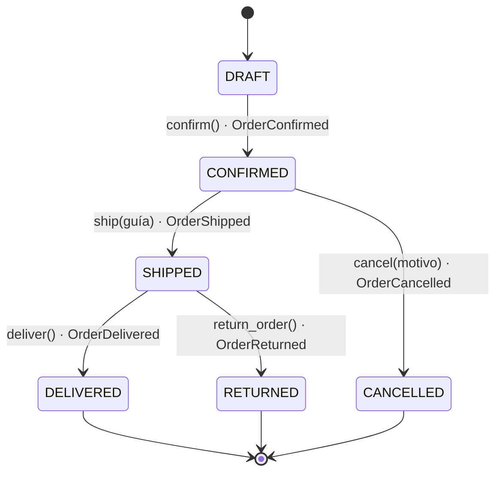

# TechStore U4 — Núcleo de negocio de pedidos

Práctica de **Componentes de Lógica de Negocio · Unidad 4** (FIME · UANL).
Dominio en Python con entidades DDD, Specification Pattern, máquina de estados,
Domain Events y API REST con FastAPI. Todo en memoria: no requiere base de datos.

## Estructura

```
techstore-u4/
├── datos/                  CSV del paquete (clientes, productos, pedidos, detalle, escenarios)
├── cargar_csv.py           Cargador del paquete (sin modificar)
├── run_scenarios.py        Ejecuta E01–E15 y genera la bitácora
├── app/
│   ├── domain.py           Money, Customer, OrderItem, Order, estados, eventos, excepciones
│   ├── specifications.py   Specifications (AND / OR / NOT) y reglas de descuento
│   └── api.py              API REST (FastAPI)
├── tests/                  Pruebas pytest (dominio, specifications, API)
└── docs/                   Diagrama de estados, bitácora y capturas
```

## Instalación

Requiere Python 3.11 o superior.

```bash
python -m venv .venv
# Windows PowerShell:  .venv\Scripts\Activate.ps1
# Windows CMD:         .venv\Scripts\activate.bat
# macOS / Linux:       source .venv/bin/activate
python -m pip install -r requirements.txt
```

## Ejecución

| Qué | Comando |
|---|---|
| Cargar los 16 pedidos | `python cargar_csv.py` |
| Ejecutar los 15 escenarios | `python run_scenarios.py` |
| Pruebas | `python -m pytest -q` |
| API | `uvicorn app.api:app --reload` |

Con la API arriba: Swagger en <http://127.0.0.1:8000/docs> y contrato OpenAPI en
<http://127.0.0.1:8000/openapi.json> (copia en `docs/openapi.json`).

## Reglas de negocio

**Dominio**
- `Money` es inmutable, usa `Decimal` (rechaza `float`), no admite negativos ni valores no finitos y solo opera en MXN.
- `OrderItem` exige SKU no vacío y cantidad > 0; el subtotal se calcula.
- Un pedido admite **máximo 20 unidades** (suma de cantidades, no renglones). Solo se agregan artículos en `DRAFT`.
- El inventario (`existencia`) es solo información del catálogo: no se descuenta.

**Descuentos (Specifications, composición `&` AND, `|` OR, `~` NOT)**
- **10 %**: cliente VIP **y** total **> 500** **y** ≥ 4 unidades **y** sin promoción.
- **5 %**: total **> 5000** **y** sin promoción.
- Si se cumplen ambas, aplica primero el 10 %.
- Una Specification solo evalúa; nunca modifica el pedido.

**Máquina de estados** (`docs/diagrama_estados.png`)



Cada método **valida primero, cambia el estado después y registra el evento al final**.
Si la operación falla, el estado no cambia y no se agrega ningún evento.

## Endpoints

| Método | Ruta | Descripción | Respuestas |
|---|---|---|---|
| GET | `/orders` | Lista de pedidos | 200 |
| GET | `/orders/{id}` | Detalle de un pedido | 200, 404 |
| GET | `/orders/{id}/discount` | Evalúa descuento (no modifica) | 200, 404 |
| POST | `/orders` | Crea un pedido DRAFT | 201, 409 |
| POST | `/orders/{id}/items` | Agrega artículo | 200, 404, 409, 422 |
| POST | `/orders/{id}/confirm` | DRAFT → CONFIRMED | 200, 404, 409, 422 |
| POST | `/orders/{id}/ship` | CONFIRMED → SHIPPED (body: `tracking_number`) | 200, 404, 409, 422 |
| POST | `/orders/{id}/cancel` | CONFIRMED → CANCELLED (body: `reason`) | 200, 404, 409, 422 |
| POST | `/orders/{id}/deliver` | SHIPPED → DELIVERED | 200, 404, 409 |
| POST | `/orders/{id}/return` | SHIPPED → RETURNED | 200, 404, 409 |
| POST | `/reset` | Recarga los CSV (útil en Swagger) | 200 |

**Códigos de error:** `404` pedido inexistente · `409` transición inválida (estado
incorrecto) · `422` datos inválidos (pedido vacío, cliente inactivo, sin guía,
sin motivo, más de 20 unidades).

## Pruebas

`python -m pytest -q` → **70 pruebas** sobre Money, OrderItem, límite de 20 unidades,
confirmación (vacío, inactivo, doble), envío sin guía, cancelación desde SHIPPED,
entrega/devolución, Specifications (umbrales estrictos, prioridad 10 % > 5 %) y API
(404, 409, 422, OpenAPI).
